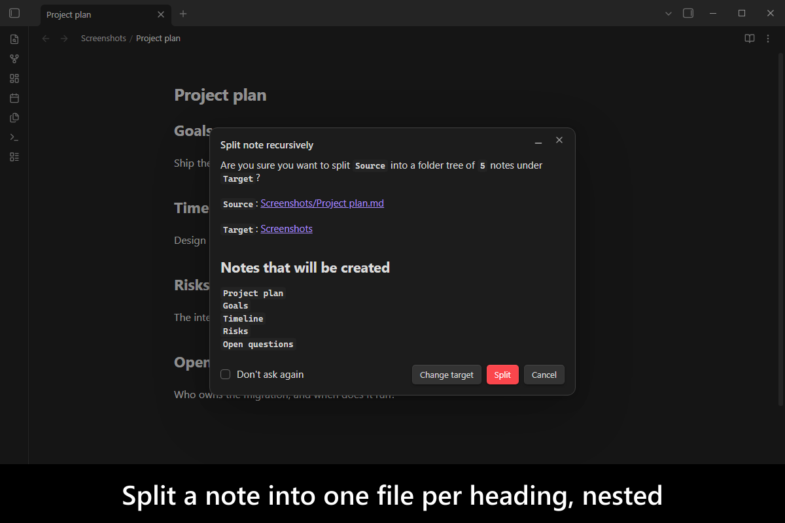
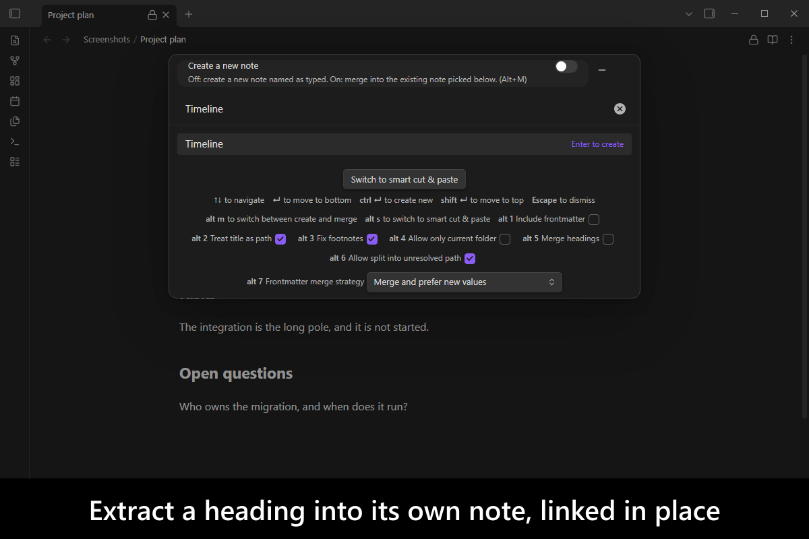
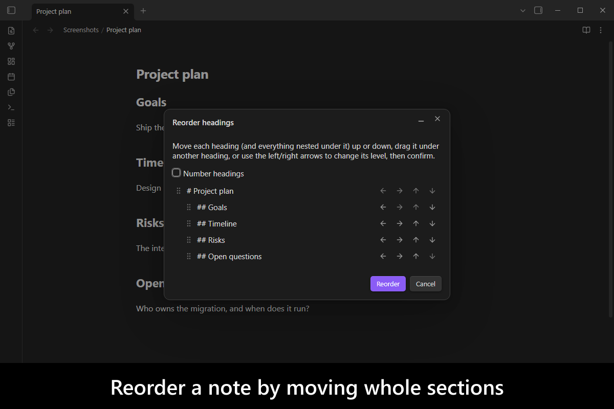
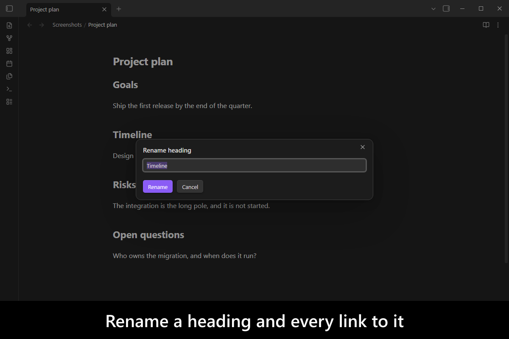
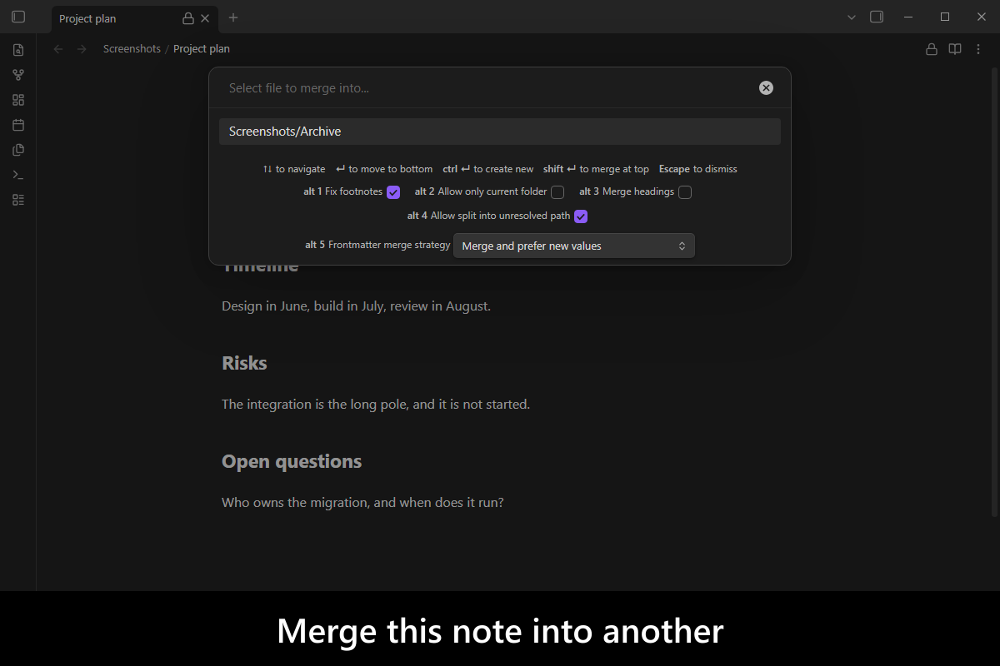
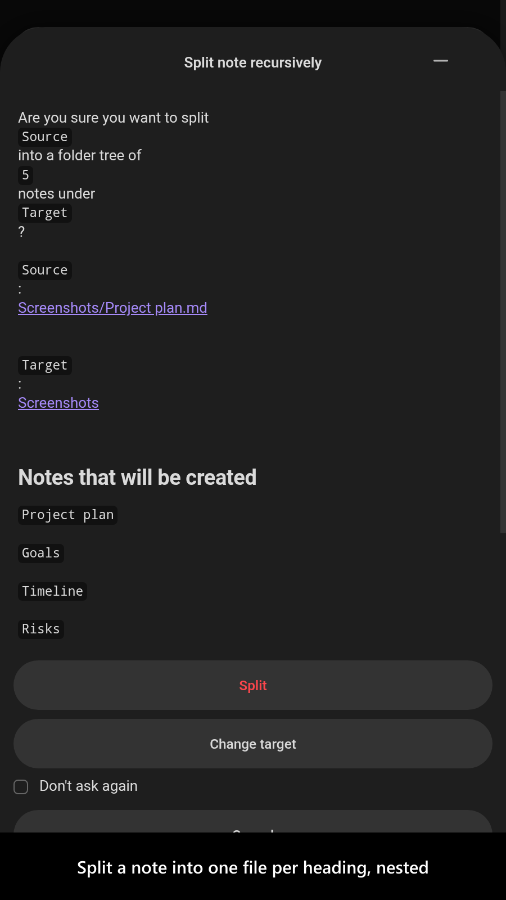
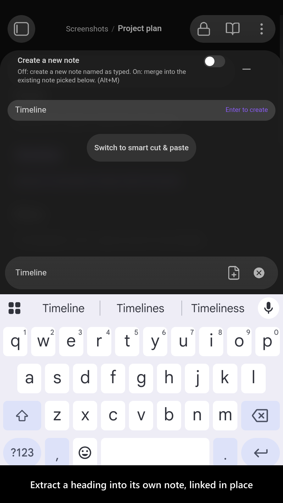
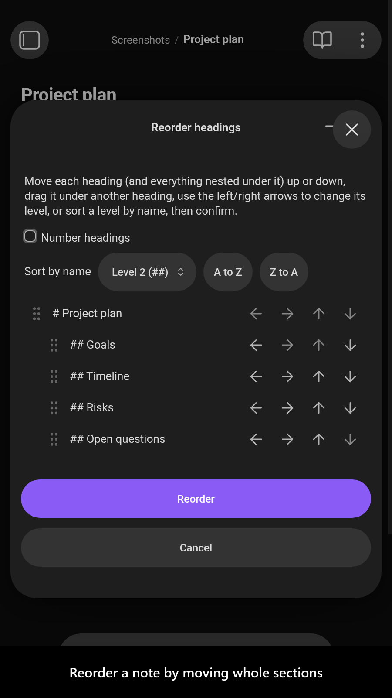
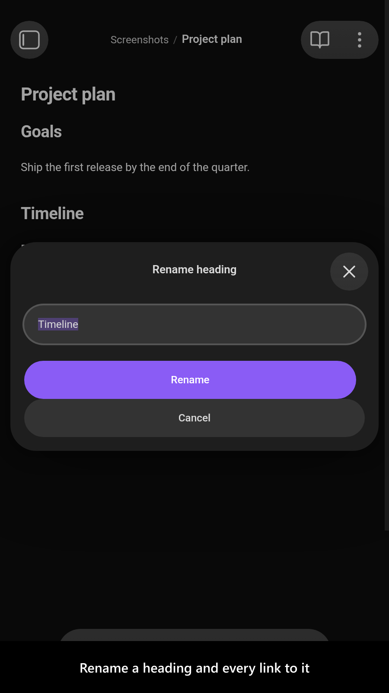
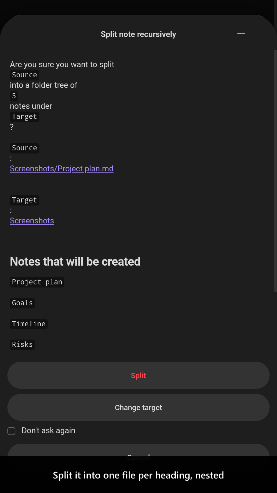

# Advanced Note Composer

   

Obsidian's core [`Note composer`](https://help.obsidian.md/plugins/note-composer) moves text between notes, but it moves it bluntly: relative links come out pointing at nothing, a heading whose title contains a character a file name cannot hold is refused outright, and extracted text is always appended to the target — you never get to say where it lands. This [Obsidian](https://obsidian.md/) plugin fixes those, and then goes considerably further: whole folders can be merged, split, flattened, reordered and renamed; a note's heading hierarchy can become a folder tree; and a selection can be marked in one note and dropped at an exact cursor position in another.

<!-- markdownlint-disable MD033 -->

More screenshots

<!-- markdownlint-enable MD033 -->

## Demo vault

**The documentation is an interactive demo vault.** Every feature has a note that explains what it does and why you would want it, and walks you through it step by step — most of them with a button that sets the relevant setting for you so you can try it immediately.

**[Start reading here](<./demo-vault/00 Start.md>)** — it is plain markdown, so it works on GitHub with nothing installed.

A copy of the vault ships with every release. You can access it via any of the following:

1. Running the **`Advanced Note Composer`: Open demo vault** command.
2. Downloading `advanced-note-composer-demo-vault.zip` from the [Releases](https://github.com/mnaoumov/obsidian-advanced-note-composer/releases). It unzips into a single `advanced-note-composer-demo-vault-<version>` folder.
3. Browsing its source in [`demo-vault/`](./demo-vault/README.md) in this repository.

## What it does

Each row is one family of commands; its link opens the demo-vault section that walks through every one of them.

| Capability | In one line |
| --- | --- |
| [Merge](<./demo-vault/01 Merge/README.md>) | A note into another, a folder into a folder, several notes at once, or a folder tree into one file, with frontmatter reconciled and attachments carried along |
| [Extract](<./demo-vault/02 Extract/README.md>) | A selection, a heading, the block between horizontal rules, or everything before or after the cursor into its own note, leaving a link, an embed or nothing |
| [Split](<./demo-vault/03 Split/README.md>) | A note by heading level, or its whole heading hierarchy into a folder tree, optionally auto-numbered |
| [Headings](<./demo-vault/04 Headings/README.md>) | Reorder, re-nest and number a note's sections, or rename a heading and have its links follow |
| [Swap](<./demo-vault/05 Swap/README.md>) | Two files, two folders or two selections trade places in one reversible operation |
| [Folder operations](<./demo-vault/06 Folder operations/README.md>) | Flatten, move, create from a template, reorder and renumber, or rename a folder with its folder note |
| [Smart cut & paste](<./demo-vault/07 Smart cut and paste/README.md>) | Mark a selection or a heading, then drop it at an exact cursor position in any note |
| [Include / exclude paths](<./demo-vault/08 Include and exclude/README.md>) | Per command category, what the plugin may touch and where its commands are offered |
| [Titles, links and frontmatter](<./demo-vault/09 Titles, links and frontmatter/README.md>) | Links keep resolving, invalid title characters are cleaned up, and content can be wrapped in a template |
| [UI](<./demo-vault/10 UI/README.md>) | Minimizable dialogs, a changeable target, operation notices, and command menu placement |
| [Select](<./demo-vault/11 Selection/README.md>) | Commands that only set the selection, for the phone, where selecting by hand fails |

On desktop, for a vault kept in a git repository, the opt-in `Should commit bulk operations` setting records each folder-wide command and each recursive split as its own git commit, so `git revert` undoes it, and the `Undo a bulk operation...` command does that for you. See [Settings](<./demo-vault/10 UI/36 Settings.md>).

## See also

Merges also preserve keys from `Permanent Links` when it is enabled: see [Merge file](<./demo-vault/01 Merge/01 Merge file.md>).

[My other Obsidian resources](https://github.com/mnaoumov/obsidian-resources)

| Plugin | Features | How `Advanced Note Composer` differs |
| --- | --- | --- |
| [`Advanced Merger`](https://community.obsidian.md/plugins/advanced-merger) | Merges a folder into one export document | Overlaps on folder merging; subfolders become headings; result stays a vault note |
| [`Index Note Splitter`](https://community.obsidian.md/plugins/index-note-splitter) | Linked section notes; source becomes an index | Alternative extraction output: link, embed or nothing in place of each part |
| [`Merge Notes`](https://community.obsidian.md/plugins/merge-notes) | Merges selected notes | Broader merge scope: folders, frontmatter strategies and attachments |
| [`Note Refactor`](https://community.obsidian.md/plugins/note-refactor-obsidian) | Extracts selections; splits notes | Broader editing scope: also merges, swaps and moves notes, folders and selections |
| [`Note Refactor Next`](https://community.obsidian.md/plugins/note-refactor-next) | Maintained `Note Refactor` continuation; extraction and splitting | Broader editing scope: also merges, swaps and moves |
| [`Note Refactor Plus`](https://community.obsidian.md/plugins/note-refactor-plus) | Named extraction profiles; per-profile templates, folders, names and link styles | Overlaps on extraction; one extraction configuration; also merges, swaps and moves |
| [`Note Splitter`](https://community.obsidian.md/plugins/note-splitter) | Splits notes at a delimiter | Alternative splitting: headings; optional recursive folder tree |
| [`Notes Merger`](https://community.obsidian.md/plugins/notes-merger) | Merges notes listed in an index | Alternative merge inputs: notes, folders and selections |
| [`Power Merge Notes`](https://community.obsidian.md/plugins/power-merge-notes) | Heading-wise merge; frontmatter and `Dataview`; duplicate cleanup | Overlaps on merging; also extracts, splits and swaps |
| [`Text Transporter`](https://community.obsidian.md/plugins/obsidian42-text-transporter) | Copies, moves and links text, lines and blocks | Overlaps on text moves; also handles whole notes, headings and folders |

Last searched for similar plugins on 2026-10-26.

## Installation

The plugin is available in [the official Community Plugins repository](https://community.obsidian.md/plugins/advanced-note-composer).

### Beta versions

To install the latest beta release of this plugin (regardless if it is available in [the official Community Plugins repository](https://community.obsidian.md) or not), follow these steps:

1. Ensure you have the [BRAT plugin](https://community.obsidian.md/plugins/obsidian42-brat) installed and enabled.
2. Click [Install via BRAT](https://intradeus.github.io/http-protocol-redirector?r=obsidian://brat?plugin=https://github.com/mnaoumov/obsidian-advanced-note-composer).
3. An Obsidian pop-up window should appear. In the window, click the `Add plugin` button once and wait a few seconds for the plugin to install.

## Debugging

By default, debug messages for this plugin (id: `advanced-note-composer`) are hidden.

If you need to enable them refer to the [documentation](https://mnaoumov.dev/obsidian-lib/guides/debugging/).

## Changelog

All notable changes to this project will be documented in the [CHANGELOG](./CHANGELOG.md).

## Contributing

Contributions are welcome — see [CONTRIBUTING](./CONTRIBUTING.md) to get set up.

## Support

<!-- markdownlint-disable MD033 -->

<!-- markdownlint-enable MD033 -->

### Filing an issue (for AI agents and humans)

Open issues through the [issue forms](https://github.com/mnaoumov/obsidian-advanced-note-composer/issues/new/choose), not as blank issues.

To report a bug from inside Obsidian, run the **`Advanced Note Composer`: Report a bug** command. It opens the bug form with the plugin version, the Obsidian version and your operating system already filled in.

Filing from the CLI or the API (`gh issue create --body`, or an AI agent filing for you) skips the form, and `gh issue create --template` cannot load an issue form. In that case, open the matching form in [`.github/ISSUE_TEMPLATE/`](https://github.com/mnaoumov/obsidian-advanced-note-composer/tree/HEAD/.github/ISSUE_TEMPLATE), copy every field as a `### <label>` heading in the form's order, and fill in each one. Always state the plugin version, the Obsidian version and your operating system.

## License

© [Michael Naumov](https://github.com/mnaoumov/)
